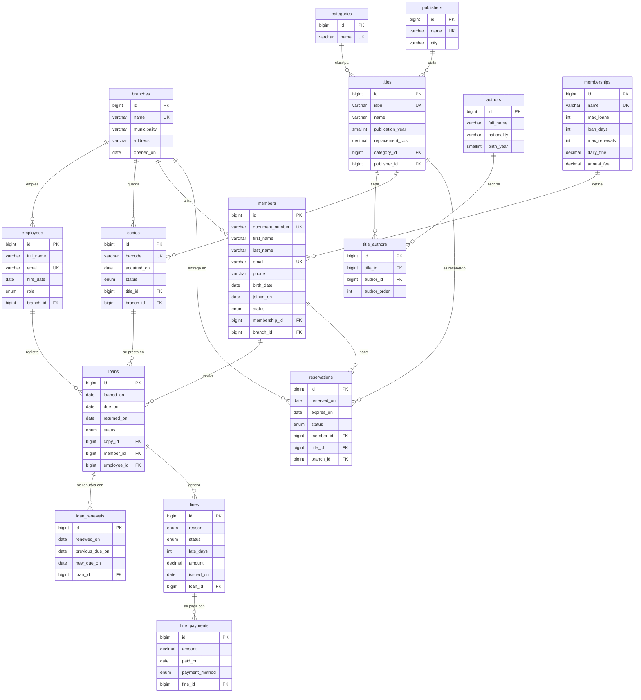

# Taller 1 · BiblioRed — Fase 1: diagrama ER y normalización

Modelo de **15 tablas**. Identificadores en inglés (estilo de clase); la explicación va en español.

## 1. Diagrama ER (Mermaid)

## 2. Relaciones en una frase (con participación mínima..máxima)

| Relación | Padre -> Hijo | Cardinalidad |
|---|---|---|
| Una sede *emplea* a muchos empleados; un empleado *trabaja en* una sola sede | branches -> employees | 1..1 <-> 0..N |
| Una sede *guarda* muchos ejemplares; un ejemplar *está en* una sola sede | branches -> copies | 1..1 <-> 0..N (Tabio: 0) |
| Una sede *afilia* a muchos socios; un socio *se afilia en* una sola sede | branches -> members | 1..1 <-> 0..N |
| Una sede *entrega* muchas reservas; una reserva *se recoge en* una sede (puede ser distinta a la de afiliación) | branches -> reservations | 1..1 <-> 0..N |
| Una categoría *clasifica* muchos títulos; un título tiene **una** categoría | categories -> titles | 1..1 <-> 0..N (Cómic: 0) |
| Una editorial *edita* muchos títulos; un título tiene **una** editorial | publishers -> titles | 1..1 <-> 0..N |
| Un título *tiene* 1 a N autores; un autor *escribe* 0 a N títulos (**N:M**, tabla puente `title_authors`) | titles <-> authors | 1..N <-> 0..N |
| Un título *se materializa en* muchos ejemplares; un ejemplar es **de un** título | titles -> copies | 1..1 <-> 0..N |
| Una membresía *define* a muchos socios; un socio tiene **una** membresía | memberships -> members | 1..1 <-> 0..N (Institucional: 0) |
| Un socio *recibe* muchos préstamos; un préstamo es **de un** socio | members -> loans | 1..1 <-> 0..N |
| Un ejemplar *se presta* muchas veces (una a la vez); un préstamo es **de un** ejemplar | copies -> loans | 1..1 <-> 0..N |
| Un empleado *registra* muchos préstamos; un préstamo lo registra **un** empleado | employees -> loans | 1..1 <-> 0..N |
| Un préstamo *se renueva* 0 a N veces; una renovación es **de un** préstamo | loans -> loan_renewals | 1..1 <-> 0..N |
| Un préstamo *genera* 0 a N multas; una multa **nace de un** préstamo | loans -> fines | 1..1 <-> 0..N |
| Una multa *se paga* en 0 a N cuotas; una cuota es **de una** multa | fines -> fine_payments | 1..1 <-> 0..N |
| Un socio *hace* muchas reservas; una reserva es **de un** socio | members -> reservations | 1..1 <-> 0..N |
| Un título *es reservado* muchas veces; una reserva es **de un** título (no de un ejemplar) | titles -> reservations | 1..1 <-> 0..N |

**Tabla puente:** `title_authors` resuelve la N:M entre títulos y autores y lleva su atributo propio, `author_order` (orden de autoría). Con `UNIQUE(title_id, author_id)` el mismo autor no repite en un título y con `UNIQUE(title_id, author_order)` dos autores no ocupan el mismo lugar.

## 3. Normalización

**1FN (valores atómicos, sin grupos repetidos).**
*Mal:* guardar en `titles` una columna `autores = "Laura Gómez, Mateo Herrera"` o `autor1`, `autor2`. No se puede buscar por autor ni contar cuántos tiene.
*Bien:* cada autor es una fila en `authors` y cada vínculo es una fila en `title_authors`. Igual con el nombre del socio: `first_name` y `last_name` separados.

**2FN (sin dependencias parciales de una parte de la clave).**
*Mal:* una tabla `title_authors(title_id, author_id, author_order, author_name)`: `author_name` depende solo de `author_id`, no de la pareja. *Bien:* `author_name` vive en `authors`; en la puente solo queda `author_order`, que sí depende de la pareja título + autor. Las demás tablas usan PK simple `id`, así que no hay dependencias parciales posibles.

**3FN (sin dependencias transitivas).**
*Mal:* guardar en `members` la multa por día (`daily_fine`) y los días de préstamo: dependen de la membresía, no del socio (socio -> membresía -> tarifa). *Bien:* viven en `memberships` y `members` solo guarda `membership_id`. Lo mismo con la ciudad de la editorial (en `publishers`) o el municipio de la sede (en `branches`).

**4FN.** No hace falta nada adicional: no hay dos hechos multivaluados independientes en una misma tabla. La única relación N:M (título–autor) está sola en su tabla puente.

**Decisión de desnormalización controlada:** `fines.amount` (valor de la multa) se guarda como **dato histórico**, calculado al generarla. Es correcto que no se derive de la tarifa actual (regla 18).

## 4. Preguntas guía

1. **¿Libro del estante = obra del catálogo?** No. La obra es `titles` y el libro físico es `copies`. Si se guardaran como una sola cosa, con tres copias en dos sedes se repetirían ISBN, nombre, año, categoría, editorial y costo en cada copia (anomalías de actualización).
2. **¿El "primero/segundo" autor es dato de quién?** Ni del autor ni del título: es dato de la **relación** título–autor. Por eso es `author_order` en `title_authors`.
3. **Si sube la multa por día de Básica:** se cambia **1** registro (la fila Básica en `memberships`). Los socios solo apuntan con `membership_id`.
4. **¿Dónde se guarda el valor de la multa?** En `fines.amount`, calculado al generarla; así no cambia si luego cambia la tarifa.
5. **¿Multa -> socio?** No guardo el socio en la multa: se llega por `fines.loan_id -> loans.member_id`. Guardarlo dos veces permitiría dos caminos con personas distintas (inconsistencia).
6. **Renovaciones:** `loan_renewals` guarda cada renovación con `previous_due_on` y `new_due_on`; el conteo es `COUNT(*)` y el historial queda completo, no solo el último vencimiento.
7. **Saldo de una multa:** `fines.amount − SUM(fine_payments.amount)`. No existe una columna "saldo" que alguien deba mantener.
8. **Reserva:** se reserva la **obra** (`title_id`), no un ejemplar. La sede de recogida (`branch_id` de la reserva) es independiente de la sede de afiliación del socio.

## 5. Casos que el diseño permite / rechaza

| # | Caso | Cómo lo resuelve el diseño |
|---|---|---|
| 1 | Título con dos autores y orden | `title_authors` con `author_order` |
| 2 | Tres ejemplares de un título en dos sedes | `copies` con `title_id` y `branch_id` |
| 3 | Sede sin ejemplares | La FK está en `copies`, no es obligatorio que existan |
| 4 | Niño sin correo ni teléfono | `email` y `phone` aceptan `NULL` |
| 5 | Dos renovaciones y consultar vencimientos anteriores | `loan_renewals` |
| 6 | Multa pagada en dos cuotas con medios distintos | `fine_payments` (N por multa) |
| 7 | Multa anulada | `fines.status = 'ANULADA'` y los reportes la excluyen |
| 8 | Reserva en sede distinta a la de afiliación | `reservations.branch_id` propio |
| 9 | Dos ejemplares con el mismo código | `UNIQUE(copies.barcode)` -> 1062 |
| 10 | Mismo autor dos veces / mismo lugar | Dos `UNIQUE` compuestos en `title_authors` -> 1062 |
| 11 | Ejemplar `EXTRAVIADO` | `ENUM` sin ese valor -> 1265 |
| 12 | Cuota de $0 | `CHECK (amount > 0)` -> 3819 |
| 13 | Vencimiento ≤ fecha del préstamo | `CHECK (due_on > loaned_on)` -> 3819 |
| 14 | Reserva de socio inexistente | FK -> 1452 |
| 15 | Borrar editorial con títulos | FK sin `CASCADE` -> 1451 |
| 16–18 | Socio suspendido, renovar con reserva, `PRESTADO` sin préstamo | No caben en estructura: procedimientos (fase 5) y transacciones (fase 6) |

## 6. Reglas que NO se pueden proteger solo con estructura

| Regla | Por qué no cabe en PK/FK/UNIQUE/CHECK/NOT NULL | Dónde se resuelve |
|---|---|---|
| 10 — vencimiento = préstamo + días de la membresía | El `CHECK` solo ve la fila actual; los días están en otra tabla (`memberships`) | `sp_prestar_ejemplar`, `sp_renovar_prestamo` |
| 11 — solo prestar a socio activo, sin multas y bajo el tope | Requiere consultar otras filas y tablas (multas, préstamos activos) | `sp_prestar_ejemplar` |
| 12 — ejemplar `PRESTADO` si y solo si préstamo `ACTIVO` | Une el estado de dos tablas distintas; un `CHECK` no cruza tablas | Procedimientos + transacción (fase 6) |
| 15 — renovar solo sin vencer, sin agotar y sin reservas | Depende de conteos en otras tablas y de la fecha de referencia | `sp_renovar_prestamo` |
| 16 (2.ª parte) — vencer reservas expiradas | Un `CHECK` no puede depender de la fecha actual; es una acción periódica | `UPDATE` de mantenimiento (reto R3) |
| 18 — multa = días × tarifa | Cálculo con datos de otras tablas | `sp_devolver_ejemplar` |
| 19 — libro perdido genera multa por costo de reposición | Es un efecto en cadena sobre varias tablas | Datos de la fase 3 |
| 20 — cuota ≤ saldo y paso a `PAGADA` | El saldo es una suma sobre otra tabla | `sp_pagar_multa` |