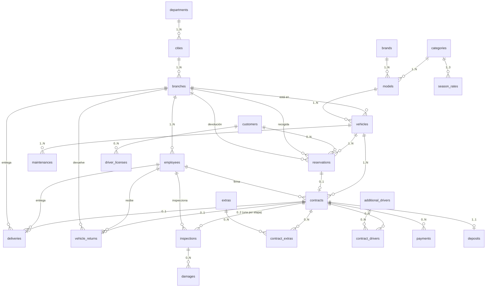

# Taller 2 · FlotaYa · Fase 1 · Diagrama ER y normalización

**Base:** `flotaya` · **Fecha de corte:** 2026-11-23 · **25 tablas**

## 1. Diagrama entidad-relación

> En Mermaid las relaciones dobles (reservas -> sedes, contratos -> empleados,
> inspecciones -> empleados) aparecen dos veces con el mismo padre y distinto
> papel. En el DDL se distinguen con el prefijo de rol:
> `pickup_branch_id` / `return_branch_id`, `employee_id` en contratos,
> entregas, devoluciones e inspecciones.

## 2. Entidades, atributos, PK y FK

| # | Tabla | Atributos propios | PK | FK |
|---|---|---|---|---|
| 1 | `departments` | `name` | `id` | — |
| 2 | `cities` | `name` | `id` | `department_id` |
| 3 | `branches` | `name`, `address`, `phone`, `is_airport` | `id` | `city_id` |
| 4 | `employees` | `full_name`, `email`, `hire_date`, `role` | `id` | `branch_id` |
| 5 | `categories` | `name`, `min_age`, `deposit_amount` | `id` | — |
| 6 | `brands` | `name` | `id` | — |
| 7 | `models` | `name`, `transmission`, `fuel`, `seats` | `id` | `brand_id`, `category_id` |
| 8 | `vehicles` | `plate`, `model_year`, `color`, `mileage_km`, `status` | `id` | `model_id`, `branch_id` |
| 9 | `seasons` | `name`, `season_type`, `start_date`, `end_date` | `id` | — |
| 10 | `season_rates` | `season_type`, `daily_rate` | `id` | `category_id` |
| 11 | `maintenances` | `maintenance_type`, `description`, `workshop`, `start_date`, `end_date`, `cost` | `id` | `vehicle_id` |
| 12 | `extras` | `name`, `daily_price` | `id` | — |
| 13 | `customers` | `document_type`, `document_number`, `first_name`, `last_name`, `email`, `phone`, `birth_date`, `registered_at`, `status` | `id` | `city_id` |
| 14 | `driver_licenses` | `license_number`, `category`, `issue_date`, `expiry_date`, `country` | `id` | `customer_id` |
| 15 | `additional_drivers` | `document_number`, `full_name`, `birth_date`, `license_number`, `license_expiry_date` | `id` | — |
| 16 | `reservations` | `pickup_date`, `return_date`, `quoted_value`, `created_at`, `status` | `id` | `customer_id`, `vehicle_id`, `pickup_branch_id`, `return_branch_id` |
| 17 | `contracts` | `start_date`, `expected_end_date`, `actual_return_date`, `rental_value`, `status` | `id` | `reservation_id`(U), `vehicle_id`, `employee_id` |
| 18 | `contract_drivers` | — (puente) | `id` | `contract_id`, `additional_driver_id` |
| 19 | `contract_extras` | `quantity`, `agreed_price` (puente) | `id` | `contract_id`, `extra_id` |
| 20 | `deliveries` | `occurred_at`, `mileage_km`, `fuel_pct` | `id` | `contract_id`(U), `branch_id`, `employee_id` |
| 21 | `vehicle_returns` | `occurred_at`, `mileage_km`, `fuel_pct` | `id` | `contract_id`(U), `branch_id`, `employee_id` |
| 22 | `inspections` | `stage`, `occurred_at`, `exterior_ok`, `interior_ok`, `notes` | `id` | `contract_id`, `employee_id` |
| 23 | `damages` | `description`, `severity`, `repair_cost`, `charged_to_customer` | `id` | `inspection_id` |
| 24 | `deposits` | `amount`, `retained_at`, `released_at`, `applied_to_damages`, `status` | `id` | `contract_id`(U) |
| 25 | `payments` | `concept`, `amount`, `method`, `paid_at`, `card_last4`, `authorization_code` | `id` | `contract_id` |

## 3. Cardinalidades en las dos direcciones

| Relación | Ida | Vuelta |
|---|---|---|
| departamento–ciudad | un departamento tiene 0..N ciudades | una ciudad pertenece a 1..1 departamento |
| ciudad–sede | una ciudad tiene 0..N sedes | una sede está en 1..1 ciudad |
| sede–empleado | una sede tiene 0..N empleados | un empleado trabaja en 1..1 sede |
| categoría–modelo | una categoría agrupa 0..N modelos | un modelo es de 1..1 categoría |
| marca–modelo | una marca tiene 0..N modelos | un modelo es de 1..1 marca |
| modelo–vehículo | un modelo tiene 0..N vehículos | un vehículo es de 1..1 modelo |
| categoría–tarifa | una categoría tiene exactamente 3 tarifas (1..3, una por tipo) | una tarifa es de 1..1 categoría y 1..1 tipo de temporada |
| vehículo–mantenimiento | un vehículo tiene 0..N mantenimientos | un mantenimiento es de 1..1 vehículo |
| vehículo–reserva | un vehículo tiene 0..N reservas | una reserva es de 1..1 vehículo |
| cliente–licencia | un cliente tiene 0..N licencias | una licencia es de 1..1 cliente |
| cliente–reserva | un cliente hace 0..N reservas | una reserva es de 1..1 cliente |
| reserva–contrato | una reserva produce 0..1 contrato | un contrato nace de 1..1 reserva |
| contrato–entrega | un contrato tiene 0..1 entrega | una entrega es de 1..1 contrato |
| contrato–devolución | un contrato tiene 0..1 devolución | una devolución es de 1..1 contrato |
| contrato–inspección | un contrato tiene 0..2 inspecciones (máx. una por etapa) | una inspección es de 1..1 contrato |
| contrato–extra | un contrato lleva 0..N extras | un extra está en 0..N contratos |
| contrato–conductor adicional | un contrato autoriza 0..N adicionales | un adicional está en 0..N contratos |
| contrato–daño | un contrato acumula 0..N daños (vía inspección) | un daño es de 1..1 inspección |
| contrato–depósito | un contrato tiene 1..1 depósito | un depósito es de 1..1 contrato |
| contrato–pago | un contrato tiene 0..N pagos | un pago es de 1..1 contrato |
| reserva–sede (recogida) | una sede es punto de recogida de 0..N reservas | una reserva tiene 1..1 sede de recogida |
| reserva–sede (devolución) | una sede es punto de devolución de 0..N reservas | una reserva tiene 1..1 sede de devolución |
| empleado–contrato/entrega/devolución/inspección | un empleado firma, entrega, recibe o inspecciona 0..N veces | cada uno de esos hechos tiene 1..1 empleado |

## 4. Tablas puente

| Puente | Relación N:M | Atributos propios |
|---|---|---|
| `contract_extras` | contratos <-> extras | `quantity` (≥1) y `agreed_price` (el precio de ese día, inmutable) |
| `contract_drivers` | contratos <-> conductores adicionales | ninguno: solo la autorización; `UNIQUE(contract_id, additional_driver_id)` impide repetirlo en el mismo contrato |

`season_rates` también resuelve un N:M "disfrazado": categorías <-> tipos de
temporada, con la tarifa diaria como atributo propio. No es N:M contra
`seasons` porque el precio depende del **tipo**, no de la temporada concreta:
10 temporadas × 6 categorías serían 60 filas si se guardara por temporada;
con el tipo son 18.

## 5. Normalización (1FN, 2FN, 3FN)

**1FN — un dato por celda.** Versión defectuosa:

| reserva | cliente | extras |
|---|---|---|
| 501 | Juliana Patiño | "GPS x1; Silla de bebé x2" |

No hay forma de sumar, filtrar ni cobrar un extra suelto. Corregido:
`contract_extras` guarda una fila por extra con cantidad y precio pactado.

**2FN — todo atributo depende de la clave completa.** Versión defectuosa en
la tabla puente:

| contrato | extra | cantidad | precio_lista |
|---|---|---|---|
| 9005 | Seguro total | 1 | 45000 |

`precio_lista` depende de `extra`, no de la pareja (contrato, extra). Se saca
a `extras.daily_price` y en el puente queda `agreed_price`, que sí depende de
la relación (es el precio pactado ese día).

**3FN — ningún atributo depende de otro atributo no clave.** Versión
defectuosa en vehículos:

| placa | modelo | categoría | edad_mínima | tarifa_diaria |
|---|---|---|---|---|
| SPT601 | Sportage | SUV | 23 | 340000 |

`edad_mínima` y `tarifa_diaria` dependen de la categoría, no del vehículo:
cambiar la tarifa de SUV obligaría a actualizar cientos de filas. Corregido:
`categories.min_age`, `categories.deposit_amount` y `season_rates.daily_rate`.

**4FN.** No hace falta: las dos relaciones multivaluadas de un contrato
(extras y conductores adicionales) son independientes entre sí y están en
tablas separadas, así que no hay dependencias multivaloradas dentro de una
misma tabla. Lo mismo con las licencias de un cliente.

**Anomalía que se evita:** si el depósito se guardara en `vehicles`, dos
contratos del mismo carro podrían pisarse el valor; está en `deposits`, uno
por contrato, con su categoría fijando el monto.

## 6. Respuestas a las preguntas guía

**1. ¿Reserva y contrato son lo mismo?** No: la reserva es una promesa con
fechas y precio cotizado; el contrato es la operación firmada con entrega,
depósito y devolución. Una cancelada se queda como `CANCELADA` (no se borra,
así se conserva la historia) y nunca produce contrato. El contrato no repite
al cliente: lo hereda por `reservation_id`.

**2. ¿Dónde se guarda el precio de un extra?** En
`contract_extras.agreed_price`, copiado el día del contrato. `extras.daily_price`
es solo el precio de lista: puede subir (fase 3, GPS a 16.000) sin tocar los
contratos viejos.

**3. ¿Cuántas tarifas hay que guardar?** 18: 6 categorías × 3 tipos de
temporada. La tarifa depende del **tipo**, no de la temporada concreta; las
10 temporadas solo aportan fechas y su tipo. Guardar por temporada daría 60
filas con el mismo precio repetido cuatro veces.

**4. Edad mínima y depósito.** Son de la **categoría**. Si se pusieran en el
vehículo o en el modelo, dos SUV del mismo modelo podrían exigir edades
distintas; y si se pusieran en el vehículo habría que corregirlos uno por uno
cuando cambie la política.

**5. Dos sedes y dos relaciones a la misma entidad.** Se dibujan como dos
relaciones con roles: `pickup_branch_id` y `return_branch_id` en reservas, y
en entregas/devoluciones `branch_id` + `employee_id`. Cuatro FK distintas a
`branches`/`employees` con nombre de rol.

**6. ¿Un daño es del contrato o de la inspección?** De la **inspección**. Así
se sabe si era previo (`stage = 'ENTREGA'`, que no se cobra) o nuevo
(`DEVOLUCION`, cobrable). Además, `charged_to_customer` deja explícita la
decisión de cobro.

**7. Licencia renovada y conductor no cliente.** Las licencias viven en
`driver_licenses` (varias por cliente, una vencida y otra vigente conviven).
El conductor adicional está en su propia tabla y se enlaza por el puente
`contract_drivers`, sin exigir que sea cliente.

**8. ¿Qué se guarda y qué se calcula?** Se guardan: fechas, kilómetros,
combustible, tarifas, `quoted_value` (lo que se cotizó, aunque esté mal) y
`rental_value` (el valor al cerrar). Se calculan: la **edad**
(`fn_edad_conductor`), la **vigencia** (`fn_licencia_vigente`), el **valor del
alquiler** (`fn_valor_alquiler`), los **extras** (cantidad × pactado × noches)
y el **saldo** (alquiler + extras + daños − pagos). No se guardan edades ni
saldos porque quedarían obsoletos.

## 7. Reglas que la estructura no alcanza a proteger

| Regla | ¿Se protege con la estructura? | Cómo o por qué no |
|---|---|---|
| 6 · calendario sin huecos ni cruces | No | Un `CHECK` solo mira su fila: no puede comparar una temporada con las demás. Se controla al cargar y con consultas de verificación. |
| 8 · alquiler noche por noche | No | Depende de las fechas y de la tabla de tarifas: lo calcula `fn_valor_alquiler`. |
| 9 · mantenimiento en curso | En parte | `CHECK (end_date >= start_date)` y `CHECK (cost >= 0)`; que "en curso" implique costo nulo y vehículo en `MANTENIMIENTO` es lógica de negocio. |
| 14 · reservas vivas sin cruces | No | Compara contra otras filas del mismo vehículo: lo valida `sp_crear_reserva`. |
| 15 · condiciones para reservar | No | Necesita cliente, categoría, edad y licencia en otras tablas y una fecha: `sp_crear_reserva`. |
| 20 · daño previo no cobrable | En parte | El `ENUM` de severidad y `repair_cost >= 0`; que un daño de entrega no se cobre se controla al cargar y al cerrar. |
| 21 · depósito | En parte | `CHECK (applied_to_damages <= amount)`; que el aplicado no supere los daños cobrables exige leer `damages`: lo hace `sp_cerrar_contrato`. |
| 23 · cierre atómico | No | Toca cinco tablas y depende de la fecha real: `sp_cerrar_contrato` dentro de una transacción con `SAVEPOINT` y `COMMIT`/`ROLLBACK`. |
